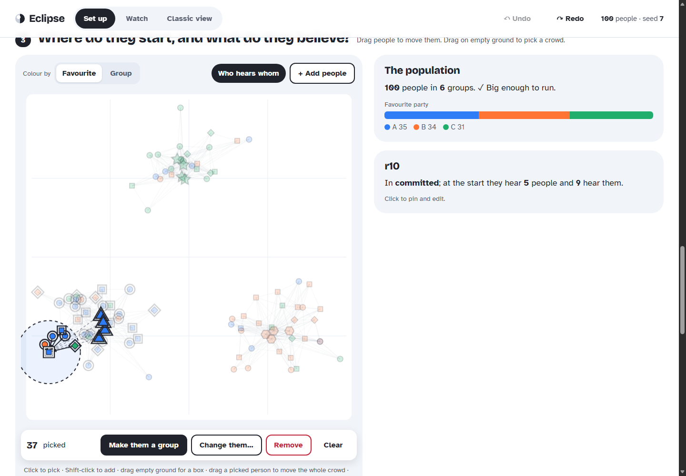
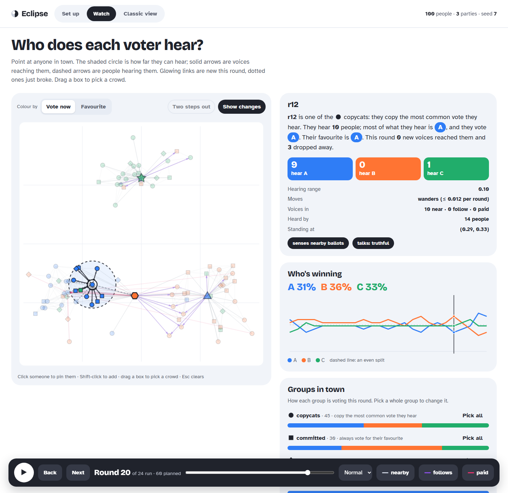

# New browser pages: Set up and Watch

`python -m multi_agent_election.cli visual <scenario.toml>` now serves three pages from the same session:

| URL | Page | Use it to |
|---|---|---|
| `/setup` | **Set up** | Build or edit an experiment by clicking; import/export TOML or JSON; check it; run it |
| `/sim` | **Watch** | Play the run, see who hears whom, read many charts over time, change people mid-run |
| `/` or `/classic` | Classic view | The original researcher page, unchanged |

Run on Windows (PowerShell; plugins folder is only needed for scenarios that use `python:` plugins):

```powershell
$env:PYTHONPATH = "src;scripts/suchit_sims/plugins"
python -m multi_agent_election.cli visual scripts/suchit_sims/showcase100.toml --port 8000
# open http://127.0.0.1:8000/sim  or  http://127.0.0.1:8000/setup
```

The look follows the approved design direction, [Explorable](direction-approved.md). The three drafts it was chosen from are in [design-demos/](design-demos/).

## Set up (`/setup`)



The page has five steps, each headed by a question:

1. **What's on the ballot?**
   - Party chips: rename by typing, remove with ×, or add with **+ Party**. New parties go last in everyone's ranking.
   - Ballot size (k).
   - Rounds, as a slider plus a number field.
   - Random seed, with a 🎲 button for a new one.
2. **Who lives in town?** One card per group:
   - **How they vote:** every built-in rule, each with a plain-English sentence.
   - **How they move:** stay put, wander, learner (`external`, for MARL) or a plugin. Includes a step-size slider and normal or uniform step lengths.
   - **How far they hear:** the group's own range, or the town default.
   - **What they say:** the communication setting.
   - **Makes links with:** shown when a graph plugin is set.
   - **Powers:** all 15 capabilities as toggles, with a one-line summary of the unusual ones.
   - **Advanced parameters** as JSON.
   - Buttons: **+ People**, **Pick them**, **Duplicate**, **Delete** (its people move to another group), and **+ New group**.
3. **Where do they start, and what do they believe?** A map of every person:
   - Drag a person to move them. Dragging a picked person moves the whole crowd.
   - Drag on empty ground to box-select; Shift-click adds or removes; Esc clears.
   - Point at someone to see their hearing range and who would hear them at round 0.
   - With a crowd picked:
     - **Make them a group:** a new group whose settings are copied from another group.
     - **Change them…:** set the group; set a full ranking for everyone or shuffle it (seeded); gather them, move them to a spot, or scatter them; set or clear a personal hearing range.
     - **Remove.**
   - Click one person to edit their group, ranking (tap a party to move it up), exact x/y and personal hearing range.
   - **+ Add people:** choose a group, a count, a favourite-party mix (exact counts), how the rest of the ranking is ordered, placement (anywhere, or around a spot), and an ID prefix.
4. **Is anyone pulling strings?** Toggle cards for:
   - town-wide hearing range and nearby mode;
   - paid campaign (`campaign_controller`);
   - rigged poll (`signal_controller`);
   - watchdog (`detector`).

   Keys the page doesn't edit (coalitions, scheduled interventions, edges, channels, nomination, and so on) are listed as **kept from your file**. They are written back untouched.
5. **Save, share, run.**
   - Live TOML or JSON of the whole scenario, with **Copy**, **Download** and **Paste or open…** (TOML or JSON, typed or from a file). Pasting a scenario anywhere on the page also imports it.
   - A live check runs the real engine's validation, including the 100-person minimum, and shows what's wrong in plain words.
   - **Run this experiment →** replaces the open simulation and goes to Watch.

**Exact replication.** Every person is written out with an explicit `position` and `preference`, alongside the `seed`. Random tools (add people, shuffle, scatter) draw from a generator seeded by the scenario seed, but their results are stored as explicit values. So the exported file alone reproduces the run exactly.

**Undo and drafts.** Ctrl+Z / Ctrl+Shift+Z cover every change. The draft is also kept in the browser's local storage, and the page offers to resume it next time.

## Watch (`/sim`)



- **Town map.** Shapes show groups, colour shows party (vote now, or favourite), and campaigners are drawn larger. Point at anyone to see:
  - their **hearing range** as a shaded circle;
  - voices **reaching them** as solid arrows (black = nearby, purple = follow, pink = paid);
  - people **hearing them** as dashed arrows;
  - **edge dynamics** (**Show changes**): links new this round glow, links that broke this round are dotted;
  - **subgraph two steps out** (**Two steps out**): who reaches the people they hear;
  - the rest of the town dimmed.
- **Right now** card:
  - a sentence about the focused person: group, rule, how many they hear and by which kind of link, what they mostly hear, how they vote, their favourite, and how many voices were gained or lost this round;
  - tiles counting what they hear for each party;
  - hearing range, movement, links in and out, position;
  - their notable **powers** as chips.

  With nobody focused, the card summarises the town or the picked crowd.
- **Who's winning** shows shares over time against an even-split guide line. **Groups in town** shows each group's vote mix for this round, with **Pick all**.
- **How is the town changing?** Up to 11 charts, each with its current value. Click or drag any chart to seek:
  - lead margin, voters switching, contacts changing;
  - people heard per voter, hearing the other side, echo chamber (share of voices that agree with the listener);
  - follow links, paid links, distance walked;
  - poll vs truth (only with a rigged poll) and the watchdog signal against its threshold (only with a detector).
- **Picking and bulk changes.** Click, Shift-click or box-select people, then:
  - **Change them…** moves them to a group, sets their beliefs, forces their next ballot (first k of a ranking you tap in), and/or gathers them or moves them to a spot. It applies after the displayed round as one all-or-nothing intervention: later rounds are re-run, and if any edit is invalid nothing changes.
  - **Make them a group** opens Set up starting from this round's positions, beliefs and groups, with the crowd as a new group, ready to tune and re-run.
- **Dock.** Play/pause, back, next (steps the engine past the last computed round, up to the planned rounds), a slider, speed, and layer toggles. Keyboard: ←/→ change the round, Space plays or pauses.
- **Deep links.** `/sim#round=24&focus=r12&pick=r03,r17` opens on round 24 with r12 in focus and two people picked.

## Server API added

All endpoints need the `X-Session-Token` header, like the existing ones.

| Method and path | Body | Returns |
|---|---|---|
| `GET /scenario` | – | `{revision, config, toml}` for the open simulation |
| `POST /scenario/convert` | `{text}` (TOML or JSON) or `{config}` | `{config, toml, json}`; changes nothing |
| `POST /scenario/validate` | `{config}` | `{ok, people, groups, parties, rounds, seed}`, or 400 with the engine's message |
| `POST /scenario/launch` | `{config}` | the same summary plus the new `revision`; replaces the session's simulation |
| `POST /command` `bulk_edit` | `{revision, action, round, edits: [{person, changes}]}` | the full snapshot; `changes` may use `group`, `preference`, `position`, `ballot`, `overrides`; all edits apply or none do |

The TOML writer is `multi_agent_election.scenario_io.to_toml`. `tomllib.loads(to_toml(c)) == c` holds for any JSON-compatible scenario.

## Tests

- `tests/test_setup_pages.py` covers:
  - TOML round trip and parse errors;
  - pages and assets carrying the token;
  - export, convert and validate (including the 403 without a token);
  - launch with exact positions, beliefs and seed;
  - per-person bulk edits;
  - all-or-nothing rollback of failed bulk edits.
- `scripts/frontend/e2e.mjs` drives headless Edge through both pages over the DevTools protocol. It runs 31 checks:
  - real pointer hover, drag and box select;
  - make group, bulk edit, add people;
  - group card toggles, renames, add and drop party;
  - TOML/JSON paste round trips, the under-100 block;
  - launch, step, a mid-run bulk edit, chart seeking, and the fork back to Set up.

  It also fails on any page exception.
