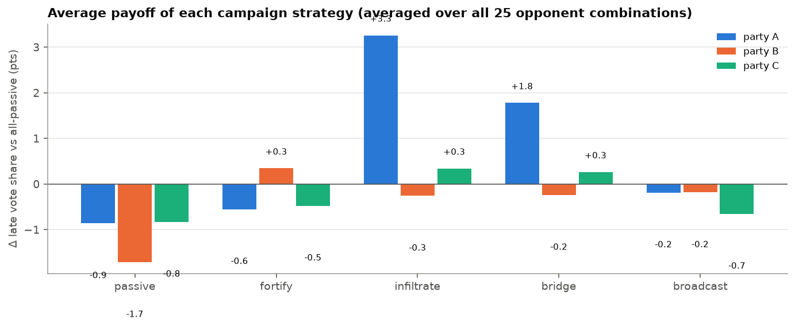
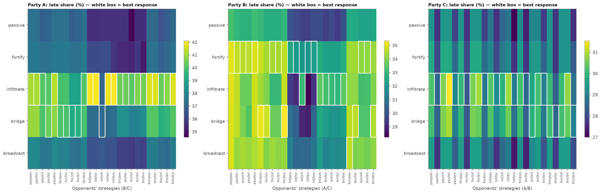
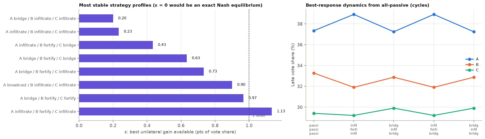
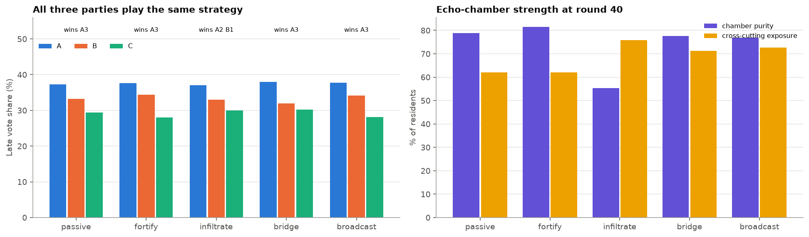
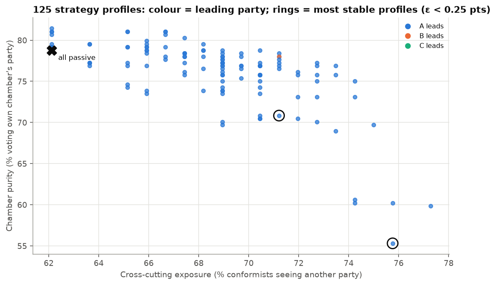
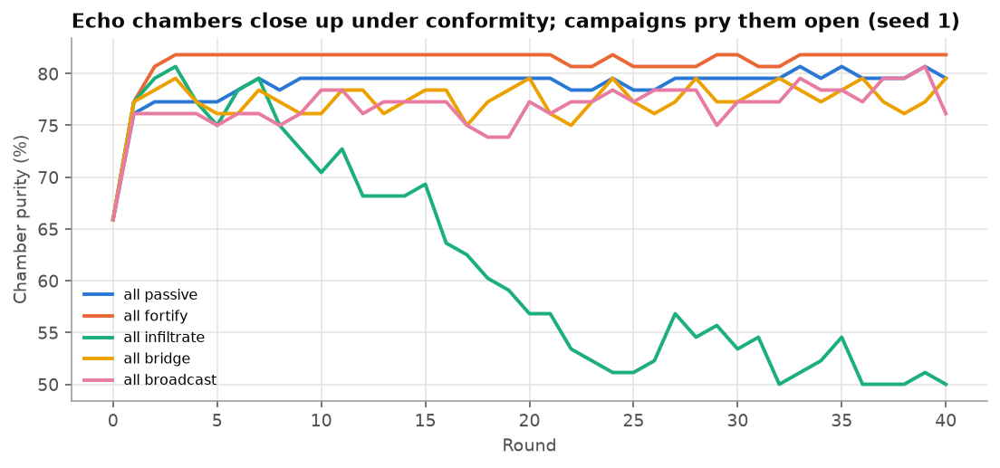
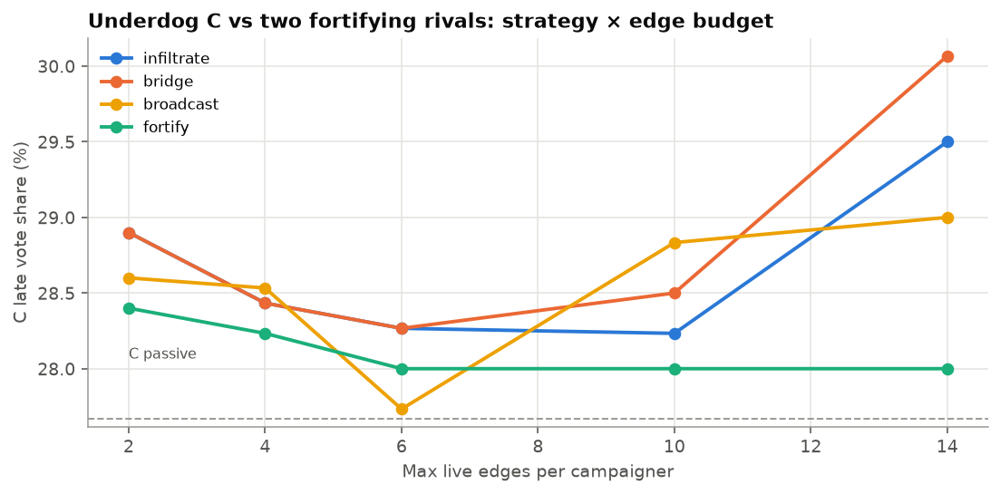
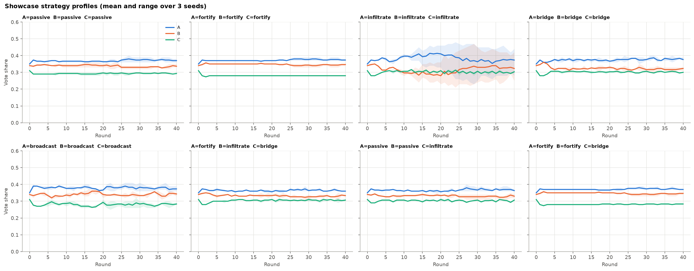
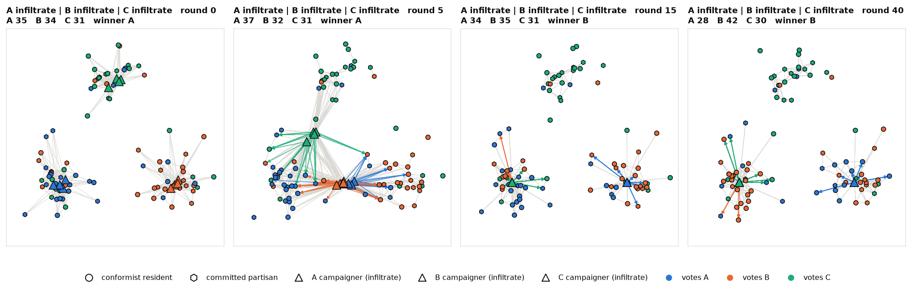

# Echo chambers under strategic party campaigns

**Question.** Voters cluster into three geographic chambers and copy what their
neighbours vote. Each of three parties has a team of strong campaigners who can
reshape who sees whom. Which campaign strategy pays off? What happens when all
three parties play strategically against each other? And do campaigns break
echo chambers, or harden them?

**Setup** (`scripts/suchit_sims/echo_chambers.py`, plugin `plugins/echo_campaign.py`)
- **100 agents.** 88 residents in three chambers: A 34, B 30, C 24. Each chamber is 65% loyal to its party (dissenters split evenly). Every party also has 4 campaigners, 12 in total.
- **Residents:**
  - 60% **conformists**: vote the plurality of the ballots they can see within 0.08, with ties broken by their own preference;
  - 40% **committed partisans**: always vote sincerely.
- **Campaigner powers:**
  - 6× faster movement (0.06 per round);
  - wide sensing (0.30), i.e. local polling;
  - the electorate roster;
  - the right to create their own "follow" edges, which put the campaigner's ballot in front of a chosen voter: at most 6 live and 2 new per round.

  Campaigners work in pairs, so each target gets two edges.
- **Strategies:**

  | Strategy | Movement | Who they link to |
  | --- | --- | --- |
  | `passive` | none | nobody |
  | `fortify` | stay home | home voters who defected, then wavering own voters |
  | `infiltrate` | move into the largest rival chamber (A's rival is B; B's and C's rival is A) | that chamber's voters who back other parties |
  | `bridge` | sit on the border with the rival chamber | voters seen switching (volatile), then rival voters |
  | `broadcast` | stay home | random roster members |

- **Design:** the full 5 × 5 × 5 factorial (125 profiles × 3 seeds × 40 rounds), plus an underdog budget sweep: **435 runs**.
- **Payoff:** a party's mean vote share over the last 10 rounds.

**Shapes:** ● conformist resident · ⬢ committed partisan. Campaigners by strategy: ■ fortify · ▲ infiltrate · ◆ bridge · ✚ broadcast · ▼ passive. Colour shows the current vote. Coloured arrows are campaign edges, coloured by party.

## Results

### Baseline (all passive)

A 37.3%, B 33.3%, C 29.4%; A wins every seed. Conformity seals the chambers:
78.8% of residents vote their chamber's party, and only 62% of conformists
ever see a ballot for another party.

### Which strategy pays (averaged over all 25 opponent combinations)

| Party | passive | fortify | infiltrate | bridge | broadcast | Best response (count of 25 opponent combinations) |
| --- | --- | --- | --- | --- | --- | --- |
| A (largest) | −0.9 | −0.6 | **+3.3** | +1.8 | −0.2 | infiltrate 19, bridge 6 |
| B (middle) | −1.7 | **+0.3** | −0.3 | −0.2 | −0.2 | fortify 13, infiltrate 6, bridge 5, broadcast 1 |
| C (smallest) | −0.8 | −0.5 | **+0.3** | +0.3 | −0.7 | infiltrate 20, bridge 5 |

Values are percentage-point changes against all-passive.

- **The front-runner should attack.** A gains most by invading B's chamber: +3.3 points on average, and up to 42.1% when B and C also infiltrate.
- **The challenger must defend.** For B, staying passive is the worst choice (−1.7), because A's infiltrators eat its chamber. Fortifying is the best average response.
- **The underdog can barely move the needle.** C's best strategy adds +0.3 points. Across all 375 factorial runs, **C never wins once**. A wins 348 and B wins 27.

### What happens when everyone plays strategically

- **There is no exact pure-strategy Nash equilibrium.** Best-response dynamics from all-passive go to (A infiltrate, B fortify, C infiltrate), then cycle forever: (bridge, infiltrate, bridge) → (infiltrate, fortify, bridge) → (bridge, infiltrate, bridge). A switches between attacking and bridging; B switches between counter-invading and defending.
- **Two profiles are stable for practical purposes.** (A bridge, B infiltrate, C infiltrate) and all-infiltrate leave every party less than 0.25 points to gain by switching, which is a quarter of one voter, inside seed noise. Both look like an **arms race of mutual invasion**. Its result is almost identical to doing nothing (A 37%, B 33%, C 30%), but the chambers are torn open.
- **B's only route to an upset** is to bridge while A *doesn't* infiltrate (A fortifies or broadcasts). B then wins 2 of 3 seeds. If A infiltrates, that chance disappears, which is why A's best response is so consistent.

### Do campaigns break echo chambers?

| All three parties play… | Chamber purity | Conformists seeing another party | Winners (3 seeds) |
| --- | --- | --- | --- |
| passive | 78.8% | 62% | A A A |
| fortify | **81.4%** (sealed tighter) | 62% | A A A |
| bridge | 77.7% | 71% | A A A |
| broadcast | 76.9% | 73% | A A A |
| infiltrate | **55.3%** (chambers broken) | **76%** | A A B |

- **Fortifying hardens echo chambers; infiltration breaks them.** The all-infiltrate equilibrium cuts chamber purity from 79% to 55% and raises cross-party exposure from 62% to 76%. Broadcast and bridge raise exposure without dissolving the chambers.
- **Breaking chambers doesn't mean changing winners.** Mutual invasion mostly reshuffles *which* voters back each party. Vote totals move little because every chamber is invaded at once.

### Can the underdog buy its way out?

Against two fortifying rivals, C's share stays between 28% and 30% for every
strategy and every edge budget from 2 to 14 edges per campaigner, a gain of at
most about 2 voters. Fortified chambers absorb a small party's campaign.

### Showcase runs

| Profile (A / B / C) | GIF | Snapshots |
| --- | --- | --- |
| passive / passive / passive | [GIF](echo_pass_pass_pass.gif) | [png](echo_pass_pass_pass_snapshots.png) |
| fortify ×3 | [GIF](echo_fort_fort_fort.gif) | [png](echo_fort_fort_fort_snapshots.png) |
| infiltrate ×3 | [GIF](echo_infi_infi_infi.gif) | [png](echo_infi_infi_infi_snapshots.png) |
| bridge ×3 | [GIF](echo_brid_brid_brid.gif) | [png](echo_brid_brid_brid_snapshots.png) |
| broadcast ×3 | [GIF](echo_broa_broa_broa.gif) | [png](echo_broa_broa_broa_snapshots.png) |
| fortify / infiltrate / bridge | [GIF](echo_fort_infi_brid.gif) | [png](echo_fort_infi_brid_snapshots.png) |
| passive / passive / infiltrate | [GIF](echo_pass_pass_infi.gif) | [png](echo_pass_pass_infi_snapshots.png) |
| fortify / fortify / bridge | [GIF](echo_fort_fort_brid.gif) | [png](echo_fort_fort_brid_snapshots.png) |

In the all-infiltrate seed above, B's and C's campaigners both pile into A's
chamber (A is the rival for both), while A's campaigners invade B's chamber.
A's chamber is hit twice and splinters, and B takes the lead by round 15 and
holds it (seed 1; across the 3 seeds B wins 1).

## Caveats

- **Only 3 seeds per profile.** The ε-equilibria and best-response cycles involve differences smaller than one voter. Read them as "these profiles are about equally good", not as a precise ranking. The averaged gains over 25 opponent combinations, and the purity/exposure effects, are much larger than that noise.
- The rival chamber is fixed (the largest other chamber). Letting C choose B's chamber instead could change C's prospects.
- Edge budgets are enforced by the campaign plugin, not the engine. The plugin uses only engine-provided observations: the roster, previous-round ballots within sensing range, and its own edges.
