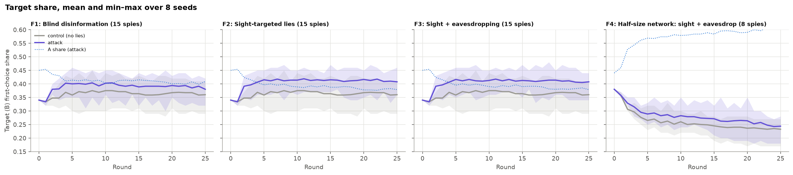
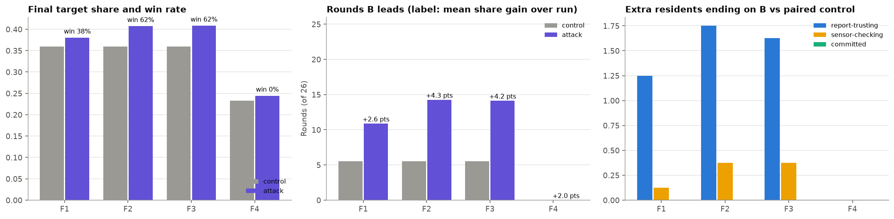
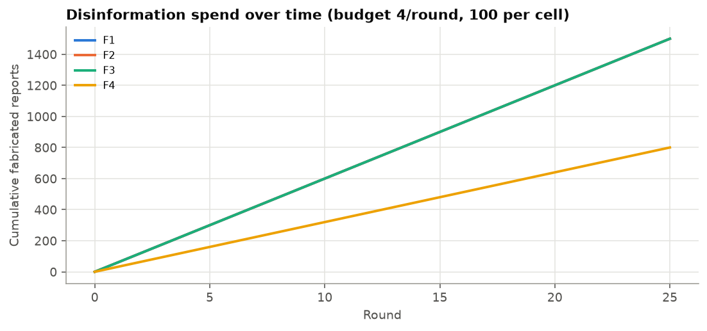
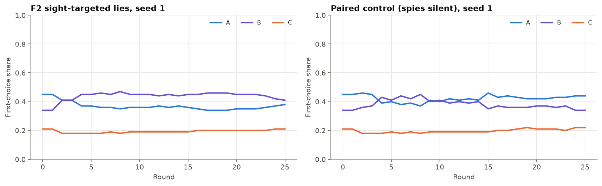
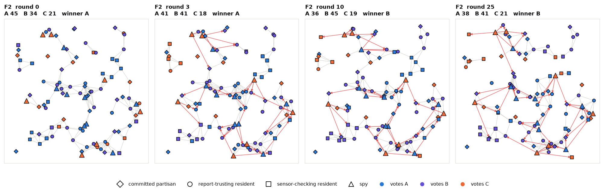

# Foreign intelligence: sleeper cells spreading targeted disinformation

**Question.** A foreign operation embeds spies in a 100-person electorate to help
party B, the underdog. How much does intelligence (knowing voters' preferences,
listening to their group chats) add to plain disinformation, and how much does
the size of the network matter?

**Setup** (`scripts/suchit_sims/foreign_intel.py`, plugin `plugins/spy_comms.py`)
- Sincere support: A 40%, B 37%, C 23% among residents.
- Residents come in three kinds:
  - **committed partisans** (40%): always vote sincerely;
  - **report-trusting** (40%): vote the plurality of the reports they receive, breaking ties by their own ranking;
  - **sensor-checking** (20%): vote the plurality of their neighbours' actual ballots, so lies can't reach them.
- Everyone reports truthfully to nearby contacts and in 10 community group chats. The spies are the exception.
- **Spies are sleeper agents.** They vote their cover party (A or C) and stay quiet except to send fabricated "I support B" reports. Lies cost budget and truthful reports are free.
- Each spy is a separate cell (one coalition per spy) with:
  - 15 local followers (outgoing edges);
  - membership of one group chat;
  - a lie budget of 4 per round and 100 in total.
- Variants with intelligence also get:
  - **sight:** a one-off dossier of the 15 followers' true rankings;
  - **eavesdropping:** interception of two nearby chats, 8 messages per round and 200 in total.
- 25 rounds, 8 seeds. Each attack is paired with a control: the same spies on the same seeds, sending nothing.

**How spies pick whom to lie to.** Report-trusting voters break local ties with their own ranking. So the cheapest people to tip are **latent B supporters who currently conform to A**, then voters who rank B second. With sight, a cell ranks its followers that way. Eavesdropping adds behavioural profiling: someone whose chat reports change over time is swayed by contacts, so they are prioritised, and someone already reporting B is skipped. Blind cells lie to random followers.

**Shapes:** ▲ spy · ● report-trusting resident · ■ sensor-checking resident · ◆ committed partisan. Colour shows the current vote. Red arrows are that round's lies.

## Results (8 seeds per variant, paired with controls)

| Variant | Win rate (attack vs control) | Rounds B leads (of 26) | Final B share gain | Mean B share gain over the run | Lies sent |
| --- | --- | --- | --- | --- | --- |
| F1 Blind disinformation, 15 spies | 38% vs 25% | 10.9 vs 5.5 | +2.0 pts | +2.6 pts | 1,500 |
| F2 Sight-targeted, 15 spies | **62% vs 25%** | **14.3 vs 5.5** | **+4.8 pts** | **+4.3 pts** | 1,500 |
| F3 Sight + eavesdropping, 15 spies | 62% vs 25% | 14.1 vs 5.5 | +4.8 pts | +4.2 pts | 1,500 |
| F4 Sight + eavesdropping, 8 spies | 0% vs 0% | 0 vs 0 | +1.1 pts | +2.0 pts | 800 |

GIFs: [F1](F1_network.gif) · [F2](F2_network.gif) · [F3](F3_network.gif) · [F4](F4_network.gif)

## Findings

1. **Intelligence more than doubles the value of each lie.** With the same 1,500 lies, the sight-guided cells (F2) gain +4.8 points against +2.0 for blind cells, and turn a 25% win chance into 62%. Blind cells waste most lies on committed partisans and sensor-checkers, who can't be moved by reports.
2. **Eavesdropping adds nothing beyond sight here.** Once the cells know who the latent B supporters are, overheard chatter mostly confirms it. Eavesdropping would matter more without sight, or if preferences changed over time.
3. **Scale matters, but F4 isn't a clean scale test.** Half the network (8 spies, F4) never puts B in front, and its gain per lie is less than half of F3's. However, with 8 spies the electorate has 92 residents and a different layout of chats and spies, and B ends at only 23% even in F4's own control (36% for the 15-spy layout). So F4 against F3 mixes network size with a less favourable starting position. A clean test would keep the residents fixed and vary only the number of spies.
4. **The gain is part conversion, part retention.** About 2 extra residents end on B compared with the control (almost all report-trusting; committed partisans never move). The rest of the roughly 5-vote gain comes from B supporters who would otherwise have conformed to A.
5. **Sensor-checking residents are nearly immune.** They see real ballots, so lies only reach them indirectly, through report-trusting neighbours who change their actual vote. This is the model's version of "verify, don't trust".

## Caveats

- Sleeper spies vote their cover party, which costs B their 15 votes. A spy who voted B could report B for free, which is a different and stronger threat.
- In the engine, sight goes to the first coalition member only and re-reads the same targets each round. One cell per spy avoids that limitation.
- 8 seeds per variant: the win rates have wide uncertainty, so read them as large-versus-small differences, not precise probabilities.
