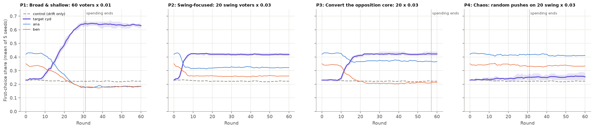
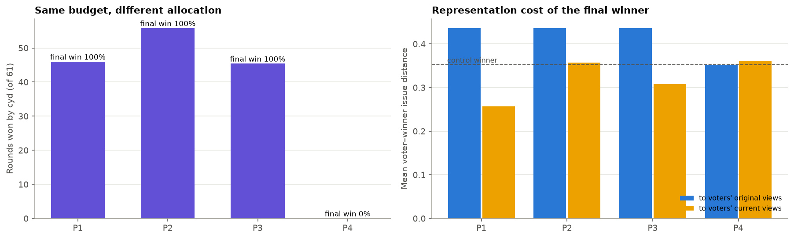
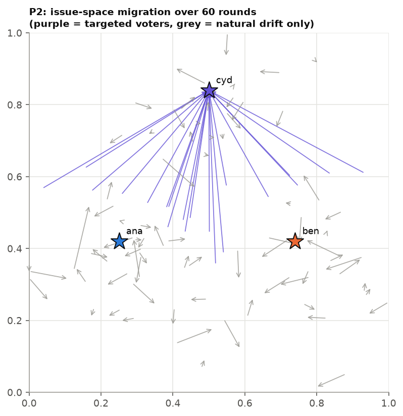
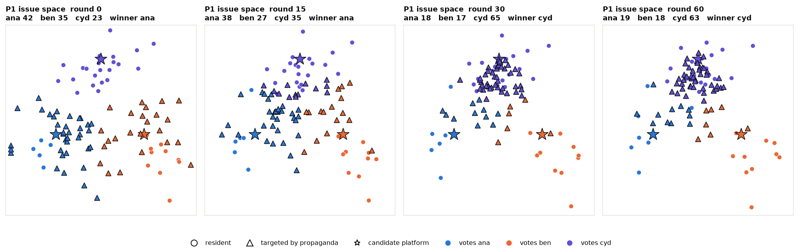

# Long-term propaganda: shifting what voters believe

**Question.** A propaganda operation has a fixed budget to shift voters' issue
positions toward candidate `cyd` (third, 23%) over a 60-round horizon while
opinions also drift naturally. How should the budget be spent? Does the effect
last after spending stops? And what does it cost in representation?

**Setup** (`scripts/suchit_sims/propaganda.py`)
- The same 100-person issue-space electorate as the watchdog study.
- Natural drift up to 0.015 per round.
- Every campaign gets the **same total budget: 18 units of L2 push**, which lasts about 30 rounds at full pace.
- 5 seeds per variant, plus a drift-only control (25 runs).
- Runs are matched by seed; the attack and drift randomness are keyed separately.

**Shapes:** ★ candidate platform · ▲ voter targeted by propaganda · ● other voter. Colour shows the current vote.

## The four campaigns

| Variant | Allocation | Final cyd share | cyd wins (rounds of 61) | First cyd win | Spending ends | Winner's distance to voters' original / current views |
| --- | --- | --- | --- | --- | --- | --- |
| Control | Drift only | 22% | 0 | – | – | 0.352 / 0.352 (ana wins) |
| P1 Broad & shallow | 60 voters × 0.01 | **63%** | 46 | r15 | r31 | 0.436 / 0.257 |
| P2 Swing-focused | 20 swing voters × 0.03 | 42% | **55.8** | **r5** | never (maintenance) | 0.436 / 0.357 |
| P3 Convert the opposition core | 20 core opponents × 0.03 | 42% | 45.4 | r16 | r57 | 0.436 / 0.308 |
| P4 Chaos | random pushes, 20 swing × 0.03 | 25% | 0 | – | r31 | 0.352 / 0.360 |

GIFs: [P1](P1_issue_space.gif) · [P2](P2_issue_space.gif) · [P3](P3_issue_space.gif) · [P4](P4_issue_space.gif)

## Findings

1. **Swing-focused propaganda wins fastest and longest.** P2 makes cyd the winner by round 5 and holds it for about 56 of 61 rounds. Swing voters need only a short push to flip.
2. **Broad, shallow propaganda builds the biggest majority.** P1 moves 60 voters a little at a time. It takes until round 15 to win, then reaches 63%. Its push also drags ana and ben's own supporters toward cyd.
3. **Converting the opposition core works, but expensively.** P3 needs about 1.6× the displacement per voter (0.64 against 0.40) and almost the whole horizon of spending to match P2's final share.
4. **Undirected noise does nothing.** Random pushes (P4) leave the result unchanged. Propaganda only works if it has a direction.
5. **The effect persists.** Once spending stops, cyd's share changes by only −1.6 points (P1) or 0 (P3). Natural drift is a random walk with no pull back toward old views, so shifted voters stay shifted. P2 never fully stops spending: drift keeps nudging its targets off cyd's platform, and the attack keeps paying small amounts to bring them back. That is ongoing maintenance.
6. **The democratic cost is hidden by its own success.** In every successful campaign the winner sits **24% further from what voters originally believed** (0.436 against 0.352 in the control). But it looks *closer* to their current beliefs (0.257 for P1). Measured against voters' views after manipulation, the result looks more representative than the honest outcome.

## Caveats

- Ideals move by the engine's bounded L2 push, with no resistance, no backlash and no memory of earlier positions. Real persuasion has diminishing returns and decays.
- The target sets were chosen by the researcher using hidden ideals; the attack has explicit permission to observe them.
- 5 seeds per variant.
