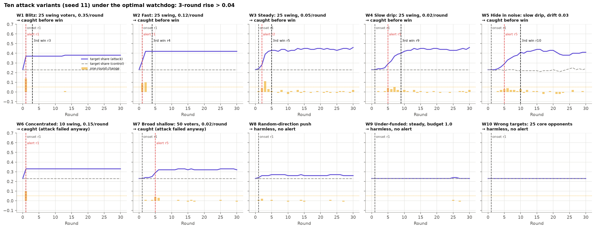
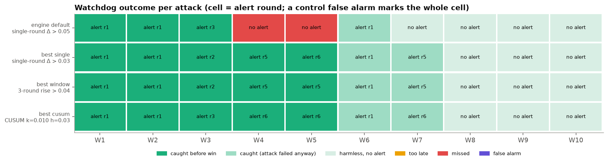
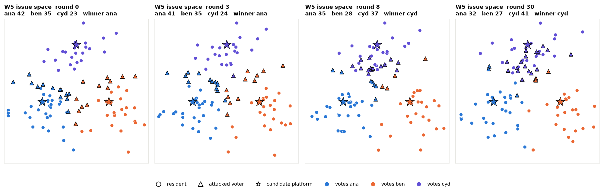
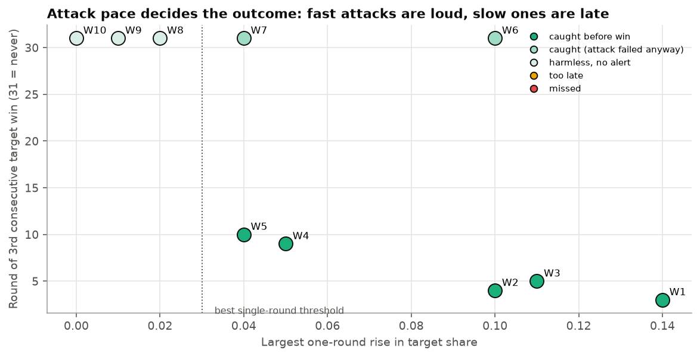
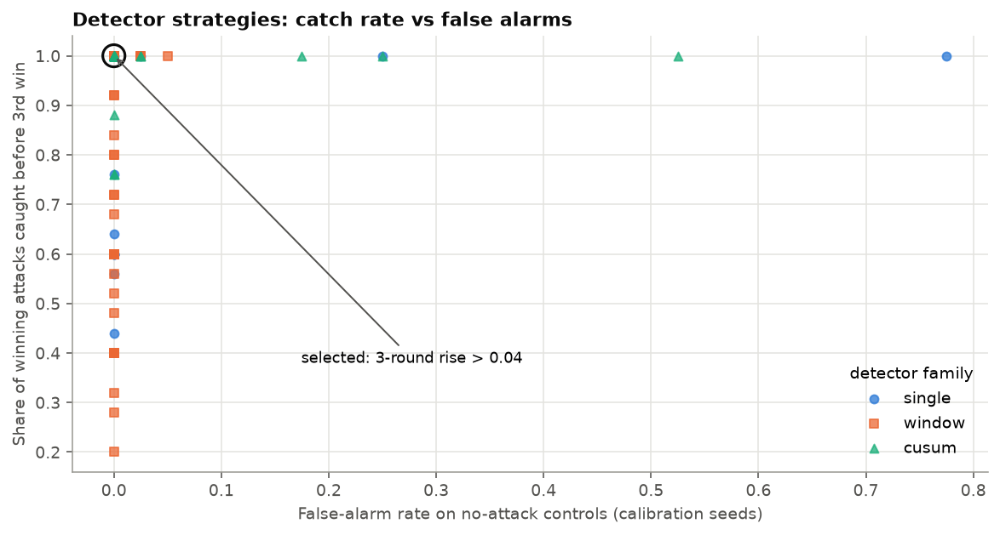
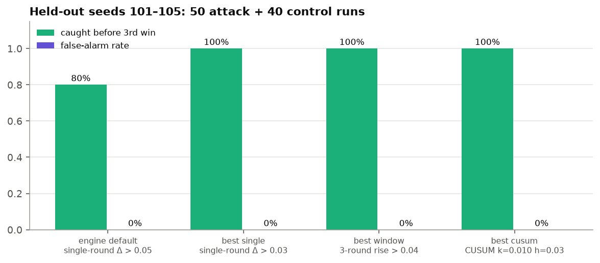
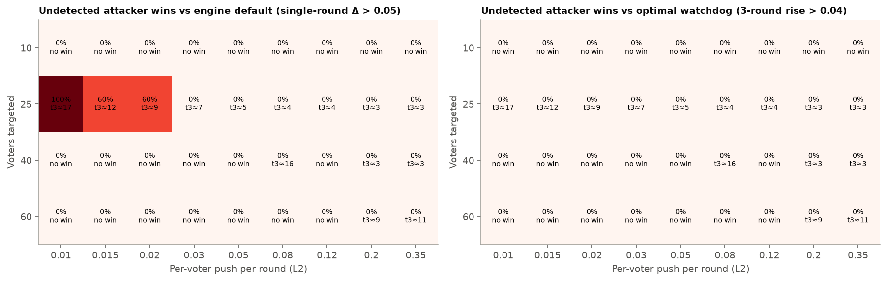

# Watchdog: catching a voter-alignment attack from public results alone

**Question.** An attacker spends a budget to shift selected voters' issue
positions toward candidate `cyd`, who starts third (ana 42, ben 35, cyd 23 of
100). A watchdog sees only the public vote counts each round. Can it raise an
alarm before `cyd` wins three rounds in a row (the "third win", the point at
which the outcome is treated as captured)? What decides who wins, and what is
the best strategy for each side?

**Setup** (`scripts/suchit_sims/watchdog.py`)
- 100 people: 97 voters plus 3 nominees, with 2-D issue ideals in three clusters. Everyone votes sincerely for the nearest platform.
- Natural drift: each voter's ideal moves up to 0.01 per round (0.03 in W5).
- 30 rounds per run. Attacks start in round 1.
- Total: 420 runs.
  - 10 showcase attacks plus 10 paired controls (seed 11).
  - Calibration: 50 attacks, 40 controls, and 40 stress controls with 1.5× drift.
  - Held-out: 50 attacks and 40 controls.
  - Attacker grid: 180 runs.

**Agent shapes in the GIFs:** ★ candidate platform · ▲ attacked voter · ● other voter. Colour shows the current vote.

## The 10 simulations

| ID | Attack | 3rd win | Largest 1-round rise | Engine detector (Δ > 0.05) | Optimal watchdog (3-round rise > 0.04) |
| --- | --- | --- | --- | --- | --- |
| W1 | Blitz: 25 swing voters, 0.35/round | r3 | 0.14 | caught r1 ✅ | caught r1 ✅ |
| W2 | Fast: 25 swing, 0.12/round | r4 | 0.10 | caught r1 ✅ | caught r1 ✅ |
| W3 | Steady: 25 swing, 0.05/round | r5 | 0.11 | caught r3 ✅ | caught r2 ✅ |
| W4 | Slow drip: 25 swing, 0.02/round | r9 | 0.05 | **missed** ❌ | caught r5 ✅ |
| W5 | Slow drip hidden in 3× natural drift | r10 | 0.04 | **missed** ❌ | caught r5 ✅ |
| W6 | Concentrated: 10 swing, 0.15/round | never | 0.10 | alert r1 (attack failed) | alert r1 (attack failed) |
| W7 | Broad shallow: 50 voters, 0.02/round | never | 0.04 | silent | alert r5 (attack failed) |
| W8 | Random-direction push | never | 0.02 | silent | silent |
| W9 | Under-funded (budget 1.0) | never | 0.01 | silent | silent |
| W10 | Wrong targets: 25 core opponents | never | 0.00 | silent | silent |

No control run raised a false alarm under either detector.

GIFs: [W1 blitz](W1_issue_space.gif) · [W3 steady](W3_issue_space.gif) · [W5 hidden in noise](W5_issue_space.gif) · [W9 under-funded](W9_issue_space.gif)

## What decides victory and loss

- **Pace is everything.** Fast attacks (W1–W3) win quickly but jump the target's share by 10–14 points in a single round, and every detector sees that. Slow attacks (W4, W5) raise the share by at most 4–5 points per round, below the engine's 0.05 threshold. They still capture the election by round 9 or 10.
- **The attacker loses by picking the wrong targets or spreading too thin.** Pushing core opponents (W10), pushing in random directions (W8), or spreading the budget over 50 voters (W7) never makes cyd win. The same budget on 10 voters (W6) moves them but not enough of them. Only the 25 voters closest to switching (swing voters) are efficient.
- **The watchdog loses by looking at one round at a time.** A single-round test can be evaded just by going slowly. A test that looks back over several rounds sees the cumulative rise.
- **Noise doesn't save the attacker here.** Tripling natural drift (W5) didn't hide the drip from the window detector.

## Finding the optimal strategy

**Watchdog.** I searched 108 detectors that all use only public counts:
- single-round thresholds (the engine's detector);
- multi-round windows (w = 2, 3, 5, 8);
- CUSUM.

The selection rule had three steps:
1. zero false alarms on 40 calibration controls;
2. **also** zero false alarms on 40 stress controls with 50% stronger natural drift (a safety margin; without it the search picked a CUSUM that false-alarmed on 2.5% of held-out controls);
3. then the highest share of winning attacks caught before the third win, then the earliest alert.

**Selected: alert if the target's share rose more than 4 points over the last 3 rounds.**

| Held-out (seeds 101–105, 50 attacks + 40 controls) | Caught before 3rd win | False alarms | Mean delay after onset |
| --- | --- | --- | --- |
| Engine default: single-round Δ > 0.05 | 80% (20/25) | 0% | 1.9 rounds |
| Best single-round: Δ > 0.03 | 100% | 0% | 2.4 rounds |
| **Best window: 3-round rise > 0.04 (selected)** | **100%** | **0%** | **2.4 rounds** |
| Best CUSUM: k = 0.01, h = 0.03 | 100% | 0% | 2.5 rounds |

Practical takeaway: the engine's default threshold is too high for slow attacks.
Lowering it to 0.03 already fixes this case. The 3-round window detector is
equally reliable, slightly faster on average, and harder to evade by pacing.

**Attacker's best response.** Against each watchdog I swept 9 push speeds × 4 target-set sizes × 5 held-out seeds, all with budget 5.

- Against the engine default, the best attack is a **slow drip on the 25 swing voters at 0.01 per round**. It wins in 100% of seeds, undetected, capturing the election around round 17. Pushes of 0.015–0.02 per round evade 60% of the time.
- Against the selected window watchdog, **no tested attack wins undetected (0% in all 36 cells)**. The attacker's least-bad option is then a blitz: it wins by round 3 but is flagged in round 1, which gives the authorities two rounds to respond.

**Outcome of optimal play:** the watchdog uses a 3-round window and the attacker
cannot avoid detection before capturing the election. In this electorate the
watchdog wins.

## Caveats

- One fixed electorate and one target; attacks always start in round 1. A delayed onset or a target that is closer to winning would make detection harder.
- Every alert here is a true attack, but in reality a slow organic swing can look identical to a slow drip. The stress controls cover only random drift, not genuine opinion trends.
- "Caught" means flagged, not stopped. No defensive response is modelled.
